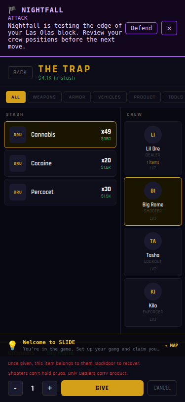
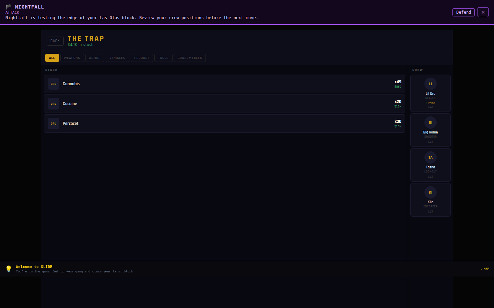

# Safe crew inventory transfer — verification record

_Manus · 2026-10-15 · [Issue #208](https://github.com/BrandDead/slide/issues/208) · base `9eef5aac28a82275d7a2e1596e8658b167953ed7`_

---

## Player outcome and authority

A player opens **TRAP** from the existing command desktop, selects a product stack and an active eligible crew member, and presses **GIVE**. The existing economy store deducts only the requested units from that exact stack; the existing roster stores the complete carried record. Recorded product risk/quality and gear stats are retained. Rejected actions do not move inventory or report success, provide visible feedback, and remain retryable. Two same-frame taps on one selected give submit once; a later explicit selection can give again.

The store action uses ESM imports, positive safe-integer requested quantities, current stock/recipient checks, existing role rules, optional exact source-stack identity, and unique carried-item IDs. Legacy unclassified `weapon` items remain blocked; no ranged/melee classification or DRIVE loadout behavior was invented. Contacts remains compatible with the action's original three arguments, but its pre-existing unconditional success message is a separately coordinated follow-up.

Demo startup previously rebuilt starter crew without its persisted inventory. The narrowly scoped reseed repair carries inventory forward only when the pre-seed player is `demo-player` and the prior member belongs to the same demo gang. It does not import another account/gang's items. Other demo reset behavior is unchanged.

**No new store, combat/economy authority, API, schema, migration, production configuration, scheduler, payment flow, asset, or multiplayer behavior was added.** Local demo persistence is not authenticated saved-game proof for #175.

## Regression-first evidence

`store-ui-red.log` records failure against unchanged main: the live action's CommonJS `require` fails at runtime. Real browser reproduction at 390×844 and 1440×900 also recorded `require is not defined` with no inventory transfer in `browser-base.json`.

`selected-batch-red.log` shows an explicitly selected second same-item stack incorrectly consuming the first stack; `inline-feedback-red.log` shows no visible rejection alert; `demo-reseed-red.log` shows two real startup/persistence regressions failing; and `browser-reload-red.log` shows the transferred carried record becoming `undefined` after real reload. These were observed before their respective fixes.

`focused-green.log` then records **35 passing tests**: 29 new transfer/UI/reseed regressions and six existing adjacent Contacts/books/progression reseed tests. `independent-review.md` records a read-only second review with **no material findings**.

## Full local gates

| Gate | Verified result |
| --- | --- |
| Full frontend tests | 1,062 passed; 4 existing intentional skips; 94 files |
| Lint | 0 errors; 200 unchanged baseline warnings |
| Typecheck and production build | Passed |
| Asset audit | 112 assets; 0 errors/warnings; 7.70 MB / 20 MB budget |
| Package validation | 5 packages; 4 schemas; passed |
| Isolated backend pytest | 107 passed |
| Diff hygiene | Passed |

Commands and raw output are retained in `full-preflight.log` and `backend-green.log`. Only terminal trailing whitespace and extra EOF blank lines were normalized for diff hygiene; assertions, outcomes and errors are unchanged. The existing oversized-bundle warnings remain. Backend tests ran with remote Supabase/database variables blank; no remote production data was accessed or changed.

## Final built-game player path

The **separately built demo artifact**, not just the dev server, was checked at **390×844, 375×812, and 1440×900**. `browser-built.json` records each assertion and raw error list. The route was mature-content notice → command desktop → TRAP → product → Lil Dre → GIVE → product → Big Rome → rejected GIVE → actual page reload → desktop → TRAP.

All three scoped paths passed: stash 50→49, one retained carried unit with the same complete persisted record after reload, denied shooter product with no second success message, visible inline rejection, and reachable GIVE hit target. There were **zero uncaught page exceptions**. Same-frame repeat, exact batch selection, stale stock/member state, and legitimate repeat-selection behavior have real component/store regression coverage; browser proof is not claimed for every unit-test case.


_Figure 1: Final 375×812 built-demo rejection state; GIVE/CANCEL remain reachable._


_Figure 2: Final 1440×900 built-demo after reload; stash remains x49 and Lil Dre carries one item._

### Existing resource failures are not hidden

This is **not clean-console or launch approval**. The built artifact exposed unchanged missing `/favicon.svg`, `/assets/game_logo.png`, and `/assets/generated/ui/icons/icon_news_v001.png`. Their files are absent from the protected base, and this repair does not alter their index/shell/sprite references. The raw evidence records 5, 4, and 4 resource-error occurrences across the three viewports including reload. The dev server's SPA fallback had hidden those HTTP 404s.

These paths were reported to the existing [visual workstream #190](https://github.com/BrandDead/slide/issues/190#issuecomment-6193823864). The runner only classifies those explicit proven-baseline 404 paths; any other HTTP error, non-resource console error, or page exception fails the scoped check. No replacement assets or hardcoded fallback URLs were added.

## Reproduction and handoff

From the repo on Node 24:

```bash
bash .agents/skills/slide-release-safety/scripts/preflight.sh src/stores/__tests__/inventoryTransfer.test.ts
cd backend/python
SUPABASE_URL= SUPABASE_KEY= SUPABASE_SERVICE_ROLE_KEY= SUPABASE_ANON_KEY= DATABASE_URL= ./venv/bin/python -m pytest tests -q
```

For the browser runner, build with `VITE_DEMO_MODE=1` into a disposable output folder, serve it on port 3001, and use an isolated Chromium profile. Copy `check-trap.mjs` to a disposable QA folder, install `puppeteer-core` there without changing repo dependencies, then run:

```bash
SLIDE_PREVIEW_URL=http://127.0.0.1:3001 \
SLIDE_EVIDENCE_DIR=/absolute/path/to/this/evidence/folder \
node /absolute/path/to/disposable-qa/check-trap.mjs built
```

The tested source/test SHA-256 values and base revision are recorded in `verification-summary.json`. Later integration must preserve every concurrent append-only project-log entry and rerun the combined candidate. Protected-main merge, production deployment, external beta, Auth/RLS and second-account proof remain separate gates. Do not replay migration 007.
