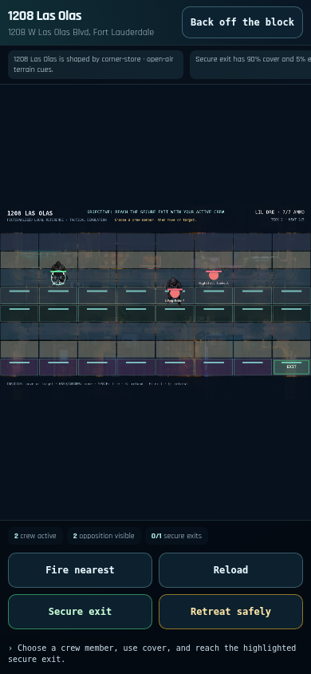
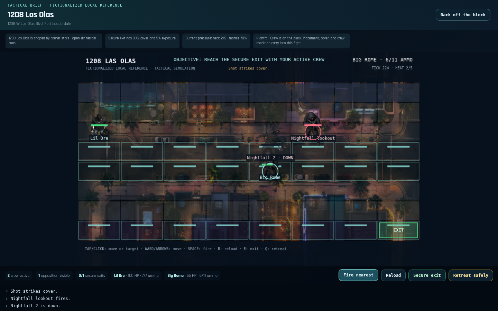
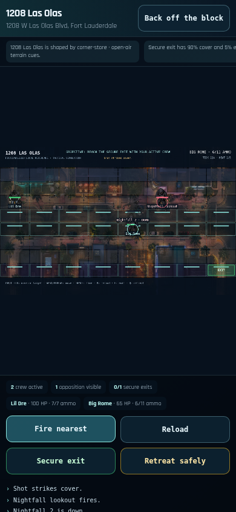
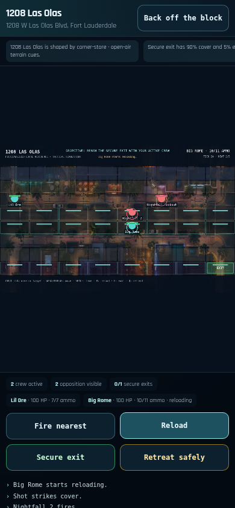

# SLIDE member graphics — existing-art integration proof

_2026-10-17 · Manus · founder-approved graphics-first coordination · evidence-only handoff_

## Review decision

**Review the existing Nightfall integration before creating another renderer or another set of placeholder members.** PR [#205](https://github.com/BrandDead/slide/pull/205), at `9227dc67d0ce174b7960ceaa06f42f865cf84abc`, replaces generic opposition circles with manifest-resolved character art, renders the block background, preserves downed-state art, and adds visible crew health/ammo/reload conditions. The inspected #205 source commit passes fresh built-demo checks on phone and desktop, including character-image failure and result persistence. #205 supplies the source repair; this branch supplies evidence only.

This handoff completes the final-source browser/capture gap described in [the original partial evidence](https://github.com/BrandDead/slide/blob/9227dc67d0ce174b7960ceaa06f42f865cf84abc/docs/evidence/2026-10-09-nightfall-presentation/README.md). It does **not** approve final character style, mark another contributor’s PR ready, merge anything, or declare the game launch-ready. The integration owner should review #205 and these captures, reconcile it with #169/#210, and repeat the relevant gates on the eventual combined commit.

## Scope and collaboration

The branch is `feature/77-nightfall-integration-proof`, based on protected `main-tL2525` at `9eef5aa`. The exact new evidence folder and append-only `docs/PROJECT_LOG.md` entry were [reserved on issue #77](https://github.com/BrandDead/slide/issues/77#issuecomment-6238033048).

No application source, asset, manifest, dependency, package, gameplay value, engine command, state writer, provider configuration, Supabase object/data, deployment configuration, secret, or existing contributor branch was changed. A detached worktree was used to build and inspect #205; it was not cherry-picked into this branch. The two local build directories were served with `python3 -m http.server`. The source-of-truth launch and collaboration documents were read from [PR #210](https://github.com/BrandDead/slide/pull/210), where they were available before merge.

GitHub is the coordination channel; no direct Grok-bot connection or reply is claimed. #169 owns identity/resolver work, #205 owns the encounter presentation repair, and #210 owns its photo-likeness/launch-readiness work. This branch supplies review evidence rather than duplicating those changes.

## What the live comparison shows

### Before: protected main


_Figure 1: Unchanged protected main, 390×844. Opponents use diagnostic circles rather than standing member art._

The strengthened browser assertions fail on **registered opposition art** and **registered downed-state art** on both viewports. All other checks in that before comparison pass. This is a controlled negative comparison, not a failing implementation introduced by this evidence PR. Both revisions passed the tested move destinations; this fresh run does not independently reproduce the historical CSS tap-offset bug.

### Existing fix: PR #205


_Figure 2: Existing #205 source, 1440×900, after real movement, firing, reload and a named opponent going down._


_Figure 3: Existing #205 source, 390×844. The individual crew-condition row is present and action buttons remain in-frame._

The read-only scene observations record real `Image` objects with runtime-manifest character paths for the opposition, including the registered shooter `_downed_` texture after an opponent is downed. They do not replace the scene, dispatch commands, patch CSS, change the clock, seed a forced victory, or mutate stores.

### Failure: registered character images unavailable


_Figure 4: All registered character-image requests deliberately aborted. Named fallback markers, crew conditions, reload and retreat remain playable._

Both viewports complete the same strategy-to-encounter-to-consequence-to-desktop path with the images unavailable. These fallback circles are a failure diagnostic, not an approved production art style.

## Verified path and results

Each run uses a fresh isolated Chromium context and the actual built demo. It enters the 18+ gate, opens the Block Loop, locks Dre/Rome, uses the player-visible **Legal board**, places Dre at `(1,2)` and Rome at `(4,3)`, equips the existing product, closes the deal, enters the named Nightfall fight, selects and moves Dre to `(0,2)` and Rome to `(4,4)`, fires, reloads to completion, downs a real opponent, retreats, applies the result, returns to the desktop and reloads.

The Legal board was used because the existing oblique Diorama’s phone hit-area overlap remains a separate issue. No `?qa=1` wound-booking shortcut was used. Phone cell inputs use real touchscreen taps; desktop cell inputs use pointer clicks. Other HTML controls use normal browser clicks. Viewports are 390×844 and 1440×900 with device scale 1 and reduced-motion enabled. This is Chromium phone emulation, not Safari or a physical iPhone test, and does not verify the full-motion branch.

| Check | Main before | #205 normal | #205 image failure |
|---|---|---|---|
| Registered opposition and downed art | Fails both | Passes both | Named fallback passes both |
| Real moves land in intended cells | Passes both | Passes both | Passes both |
| Fire and reload-complete engine events | Passes both | Passes both | Passes both |
| Individual health/ammo/reloading row | Not present | Passes both | Passes both |
| One applied demo receipt after reload | Passes both | Passes both | Passes both |
| Booked money/heat/morale/crew preserved | Passes both | Passes both | Passes both |
| Uncaught page errors | 0 each | 0 each | 0 each |
| Console errors, phone / desktop | 4 / 3 | 4 / 3 | 20 / 19 |

The normal-build console errors are existing HTTP 404s for `/favicon.svg`, `/assets/game_logo.png`, and `/assets/generated/ui/icons/icon_news_v001.png`. The phone requests the favicon again after reload. Image-failure runs additionally contain 16 intentionally aborted character-resource errors. Those errors are recorded, not hidden or called a zero-error console. The raw reports include failing URLs and engine/session/texture observations.

The demo ledger’s one applied encounter key, booked cash, player heat, block morale and crew conditions survive reload. This is local demo evidence only: it does not prove authenticated Supabase durability, backend health-write retries, or resistance to deliberate receipt tampering.

## Automated gates on the inspected #205 commit

Run with repository-required Node `24.22.0` and locked frontend dependencies:

| Gate | Result | Evidence |
|---|---|---|
| Focused scene and condition-HUD tests | 7 passed / 2 files | [Focused log](pr205-focused.log) |
| Full `npm run validate` | Exit 0 | [Validation log](pr205-validate.log) |
| TypeScript | Passed | Validation log |
| ESLint | 0 errors / 200 existing warnings | Validation log |
| Frontend tests | 1,039 passed / 4 skipped / 92 files | Validation log |
| Runtime asset audit | 112 assets / 7.70 MB of 20 MB; 0 errors/warnings | Validation log |
| Asset package schemas | 5 packages / 4 schemas valid | Validation log |
| #205 demo production build | Passed | [Candidate build log](pr205-build.log) |
| Protected-main demo build | Passed | [Before build log](main-build.log) |
| Published #205 CI | Frontend and backend successful on inspected head | [Captured check record](pr205-checks-current.json) |
| Evidence branch’s own `npm run validate` | 1,033 passed / 4 skipped / 91 files; typecheck and both asset gates passed | [Evidence branch log](evidence-branch-validate.log) |

The evidence branch also has 0 lint errors and the same 200 existing lint warnings. Existing large-chunk and legacy background-reference build warnings remain. No new runtime art or dependency was added to achieve the improvement. Evidence files are review material, not part of the runtime asset budget.

## Remaining visual and launch blockers

The screenshots show a material improvement over generic circles, but **not the final member quality requested by the founder**. Several armed roles still share the same hooded model. The topdown sprite camera and oblique block presentation are not a finished shared cinematic camera system. On phone, the preserved full tactical plane is small, canvas labels are tiny, and substantial letterboxing remains; visible DOM condition/action controls do not make the in-world art premium. Missing aim/fire/hit/reload pose coverage and identity continuity across roster, street, topdown and future rigged models still need the agreed hero-member package/style approval.

The reported “South Park” look was also found in #210’s earlier photo-likeness compositor fallback. Its current branch had already removed that flat body fallback and used photo portraits, so reproducing that old fix would conflict with active work. This proof does not exercise #210’s photo pipeline or assert its readiness.

The repository contains a real Babylon Modern Ops facade and a CC0 rigged pipeline stand-in, but normal block-screen controls currently expose the canonical UnifiedEncounter, not Modern Ops. The graphics lab is a development fixture, not a player-path proof. The rigged stand-in is not approved final member art, a production Las Olas block GLB is absent, and no first-person-arms package is present. A browser-FPS reference is useful as quality inspiration, not justification to replace the strategy game with robot waves or another disconnected engine.

Recommended next handoff: the integration owner reviews #205 with these final-source captures, then reserves one hero member/camera/identity package with #169/#210 owners. Approve that member at actual roster, street and combat sizes before expanding the roster. Any eventual 3D fight must keep the canonical Block DNA board, deployed identities, existing combat/result authority and once-only strategy consequence path. Production promotion and authenticated save proof remain separate launch gates.

## Reproduce and inspect

[Verification summary](verification-summary.json) indexes the six raw `*-report.json` reports. Every screenshot named in those reports is included here, including result, consequence, return and reload captures. These are uncomposited browser captures; no generated mockup is presented as a running game.

```bash
# Build each inspected revision in its own worktree using Node 24.
cd frontend
npm ci
VITE_DEMO_MODE=1 npm run build
python3 -m http.server 4173 --bind 127.0.0.1 --directory dist

# In another shell, install QA tooling outside the project dependency tree.
npm install --prefix /tmp/slide-qa playwright-core
export QA_NODE_MODULES=/tmp/slide-qa/node_modules

# From the repository root. Chromium is required; set CHROMIUM_PATH if different.
node docs/evidence/2026-10-17-member-graphics-integration/qa-player-path.mjs \
  http://127.0.0.1:4173 /tmp/slide-qa-normal pr205
node docs/evidence/2026-10-17-member-graphics-integration/qa-player-path.mjs \
  http://127.0.0.1:4173 /tmp/slide-qa-failure pr205-failure fail-images
```

For the protected-main negative comparison, serve that revision separately and use label `main`. Its script exit code 1 is expected for the two absent-art checks. The QA script’s React-ref observer is intentionally local and read-only; a future React/scene refactor may require observer maintenance rather than a game-code workaround.

Rollback for this evidence-only PR is a revert of its documentation/evidence commit. It changes no runtime behavior. No merge, database action or production deployment was performed.
